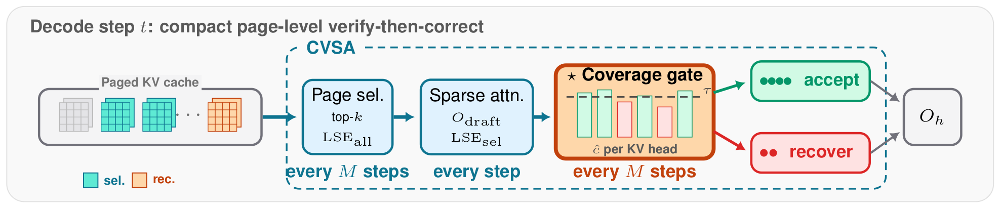
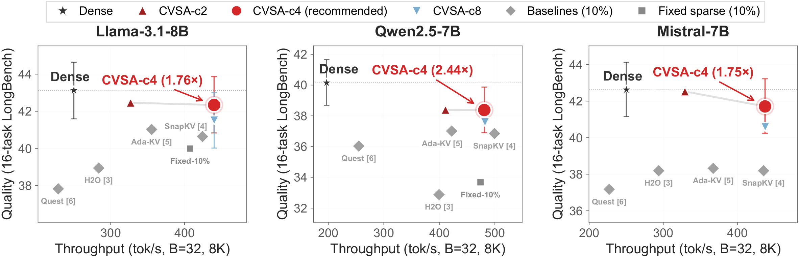

<div align="center">
<h1>Coverage-Verified Sparse Attention:<br>Closed-Loop Quality Control for Long-Context LLM Decoding</h1>

<b>Yan-Cheng Li</b>, <b>Chun-Yi Lee</b>

<b>NeurIPS 2026</b>
</div>

<br>

<p align="center">
  
</p>
<p align="center"><sub>
<b>One decode step of CVSA.</b> A page selector drafts a sparse attention output together with its LSE statistics;
a per-head coverage gate accepts heads whose coverage reaches τ and sends the rest to recovery.
Page scoring and the coverage gate run together every M steps; sparse attention runs on every step,
reusing the selected pages in between.
</sub></p>

## News

- **[2026.09]** CVSA is accepted to NeurIPS 2026.

## TL;DR

Sparse attention reads only part of the KV cache, but it commits to its page
selection blind: nothing tells it when the selected pages miss too much
attention mass. CVSA measures that mass, the **coverage** of the selected
pages, from quantities the sparse kernel already computes, and verifies each
head before committing its output. Heads above a threshold keep the cheap
sparse result; the rest are recovered. It is training-free and works with an
off-the-shelf page selector.

## Abstract

Sparse attention accelerates long-context decoding by reading a subset of the
KV cache, but existing methods are open-loop: the kernel commits to its
selection with no signal indicating whether enough attention mass was preserved
and no recovery path when it was not. The needed signal already exists inside
the kernel. The fraction of softmax mass on the selected tokens, which we call
*coverage*, satisfies an exact algebraic equality with per-step output error
and serves a dual role as the acceptance criterion and the interpolation weight
for recovery. *Coverage-Verified Sparse Attention* (CVSA) turns coverage into a
training-free, closed-loop verify-then-correct decode loop that accepts
high-coverage drafts and recovers only the heads that fall short, with no
sampling, no draft model, and no speculative-decoding infrastructure. Turning
verification on matters far more than tuning its threshold, and matched-budget
comparisons confirm the gain is structural. On LongBench at 7B and 70B, CVSA
comes within 1.13 points of dense attention, statistically matching it at 70B,
and it loses 0.8 points on RULER; measured throughput reaches 6.21× at 128K
context.

## Results

<p align="center">
  
</p>
<p align="center"><sub>
LongBench quality (16-task average) against decode throughput (batch 32, 8K context) on three 7B models.
CVSA-c4 is labeled with its speedup over dense attention; error bars are bootstrap 95% intervals.
Baseline reference numbers follow the paper.
</sub></p>

| | |
| --- | --- |
| LongBench, 7B | within **1.13** points of dense attention |
| LongBench, Llama-3.1-70B | statistically matches dense attention |
| RULER | **−0.8** points vs. dense |
| Decode-step speedup (median) | up to **6.21×** at 128K context |

## Installation

The GPU experiments target Linux with NVIDIA GPUs (paper: H100 and H200).

```bash
git clone https://github.com/DJ-Melvin/coverage-verified-sparse-attention.git
cd coverage-verified-sparse-attention
pip install -r requirements.txt   # Python 3.10; torch / triton / flashinfer builds must match your CUDA driver
export PYTHONPATH=$PWD:$PYTHONPATH
```

Model weights are the public Hugging Face checkpoints
`meta-llama/Llama-3.1-8B-Instruct`, `mistralai/Mistral-7B-Instruct-v0.3`,
`Qwen/Qwen2.5-7B-Instruct`, `meta-llama/Meta-Llama-3.1-70B-Instruct`, and
`deepseek-ai/DeepSeek-R1-Distill-Llama-8B` (reasoning experiment).

## Quick start

Run dense attention and CVSA on one LongBench task:

```bash
python eval/longbench_cvsa.py \
  --model meta-llama/Llama-3.1-8B-Instruct \
  --methods dense,cvsa_5_90_c4_ar20_dL0 \
  --tasks hotpotqa --max-samples 5 \
  --output results/quickstart.json
```

Redraw every figure of the paper from the shipped results (CPU only):

```bash
bash scripts/make_figures.sh
```

## Method strings

Methods are selected by name in `--methods`. The configuration behind the
paper's results is `cvsa_5_90_c4_ar20_dL0`:

| Token | Meaning |
| --- | --- |
| `cvsa_5_90` | 5% base page budget, coverage threshold τ = 0.90 |
| `c4` | page scoring and the coverage check run every M = 4 decode steps; in between, the selected pages are reused |
| `ar20` | approximate recovery for rejected heads, expanding to 20% of pages |
| `dL0` | layer 0 always dense |

Adding `cv1` (e.g. `cvsa_5_90_c4_cv1_ar20_dL0`) keeps page scoring every M
steps but runs the coverage check on every step against the cached scores.
The 70B results use `c2` (M = 2). Baselines are `fixed_{B}` (fixed budget, no
verification), `snapkv_{B}`, `adakv_{B}`, `h2o_{B}`, and `quest_{B}`. The full
grammar is in the `make_backend` docstring of `eval/longbench_cvsa.py`; the
prefix `ssa_` is accepted as an alias of `cvsa_`, and some stored result files
use it.

## Reproducing the paper

[REPRODUCIBILITY.md](REPRODUCIBILITY.md) maps every table and figure to the
command that produces it.

## Repository layout

| Path | Contents |
| --- | --- |
| `cvsa/` | The method: `backend.py` (CVSA decode backend), `complement.py` and `lse_merge.py` (exact recovery), `tactic.py` (Tactic reproduction), `kernels/` (Triton page scoring, sparse decode and coverage kernels), `runtime/` (paged KV cache, model loader, dense decode backend) |
| `eval/` | LongBench (`longbench_cvsa.py`; prompts, metrics and runner in `longbench_harness.py`; baselines in `baselines.py`), RULER, latency, diagnostics, analysis, and plotting scripts |
| `scripts/` | Slurm launchers for every experiment in the paper (set the account, partition and environment for your cluster) |
| `results/` | The inputs of the paper's figures; launchers write their outputs here |
| `paper/figures/` | The paper's figures; the plotting scripts write here |
| `tests/` | Unit tests for the Triton kernels, exact recovery, effective-budget accounting, and the Tactic reproduction |

## Citation

```bibtex
@inproceedings{li2026cvsa,
  title     = {Coverage-Verified Sparse Attention: Closed-Loop Quality Control for Long-Context {LLM} Decoding},
  author    = {Li, Yan-Cheng and Lee, Chun-Yi},
  booktitle = {Advances in Neural Information Processing Systems},
  year      = {2026}
}
```

## License

MIT; see [LICENSE](LICENSE). The Twilight audit runs the official Twilight
implementation (https://github.com/tsinghua-ideal/Twilight), which is not
included here and is distributed under its own license.
